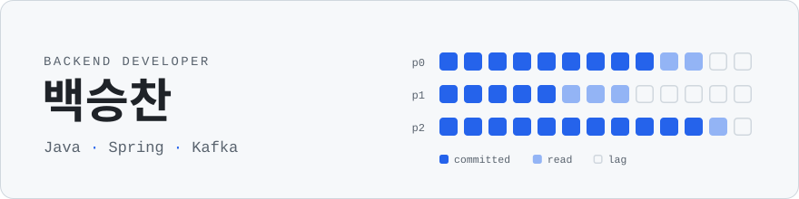

<picture>
  <source media="(prefers-color-scheme: dark)" srcset="assets/header-dark.svg">
  
</picture>

Java·Spring으로 백엔드를 만드는 개발자입니다. 메시지 전달 보장, 트랜잭션 정합성, 장애 복구, LLM 연동처럼 실패했을 때의 동작이 중요한 부분을 주로 다룹니다.

다루는 기술은 조건을 바꿔 가며 재현해 보고, 결과를 글과 실습 코드로 공개합니다.

**[블로그](https://blog.baekchan.com)** · **[실습 저장소](https://github.com/BaekChan1024/my-minimal-playground)** · **[이메일](mailto:baekchan1024@gmail.com)**

## 기술 스택

| 분야 | 기술 |
|---|---|
| **Language & Framework** | Java 21, Spring Boot 3·4, Spring WebFlux, JPA·Hibernate, QueryDSL, Quartz |
| **Messaging** | Kafka, RabbitMQ, Debezium |
| **Data** | PostgreSQL, MariaDB, ClickHouse, OpenSearch, Redis |
| **API & AI** | REST, gRPC, GraphQL, SSE, MCP, Spring AI |
| **Infrastructure** | Docker, Kubernetes, AWS |
| **Test** | JUnit, Testcontainers |

## 다루는 기법

| 영역 | 기법 | 확인한 글 |
|---|---|---|
| **Kafka** | 오프셋·커밋 경계와 리밸런스, 트랜잭션과 producer fencing, 멱등 전송, 복제와 acks, retention·compaction, lag 진단 | [글&nbsp;12편](https://blog.baekchan.com/category/kafka) · [코드](https://github.com/BaekChan1024/my-minimal-playground#kafka-실습) |
| **이벤트 전달 보장** | Transactional Outbox, Inbox 멱등 소비, 재시도와 DLT 재처리, 폴링 릴레이에서 Debezium CDC로 전환 | [아웃박스&nbsp;기초](https://blog.baekchan.com/post/아웃박스-기초-1-테이블트랜잭션커밋부터-이해하기) · [CDC&nbsp;전환](https://blog.baekchan.com/post/outbox-폴링에서-debezium으로-같은-이벤트를-보내기-위한-조건) |
| **이벤트 설계** | Zero Payload·Thin Event·Fat Event 비교, 원본 조회 장애 시 소비자 동작 | [Zero&nbsp;Payload](https://blog.baekchan.com/post/이벤트에-id만-보내면-무엇이-달라질까-zero-payload와-fat-event-여섯-가지-실험) |
| **분산 트랜잭션** | Saga 오케스트레이션과 코레오그래피, 보상 처리, 중복·늦은 응답 대응, 격리 부재로 생기는 이상 현상 | [Saga](https://blog.baekchan.com/post/saga를-중앙에서-조율할까-이벤트로-이어-갈까-같은-saga를-두-번-구현해-비교한-여섯-가지-실험) |
| **Spring · JPA** | 트랜잭션 프록시·전파·롤백 규칙, flush와 커밋 시점, 낙관적 잠금, 격리 수준, readOnly 트랜잭션 | [글&nbsp;6편](https://blog.baekchan.com/category/spring) · [코드](https://github.com/BaekChan1024/my-minimal-playground#spring-실습) |
| **조회 모델** | CQRS 조회 모델 분리와 지연 관측, 집계 모델, read replica, Keyset 페이지네이션 | [CQRS&nbsp;실전](https://blog.baekchan.com/post/cqrs-실전-1-조회-모델이-원본을-잘-따라가고-있는지-어떻게-알까) |
| **PostgreSQL · Redis** | 실행 계획과 통계, 복합 인덱스 설계, 조인 방식, VACUUM, Redis 중복 제거와 집계 | [데이터베이스](https://blog.baekchan.com/category/데이터베이스) |
| **LLM 연동** | MCP 게이트웨이와 도구 설계, SSE 스트리밍 중계, LLM에 맡길 일과 서버 규칙의 분리, 평가 세트로 검증 | [LLM이 판단하게 둘 것인가](https://blog.baekchan.com/post/llm이-판단하게-둘-것인가-이벤트를-공격으로-묶는-일을-서버-규칙으로-옮긴-기록) |
| **운영 · 관측** | Gateway 지표와 알림, 커넥션 풀 대기 진단, 비동기 작업의 trace 연결, 서비스 전환과 롤백 | [서버&nbsp;운영](https://blog.baekchan.com/category/서버-운영) |

## 최근 글

<!-- recent-posts:start -->
- [인기 글에 Redis가 필요했을까? 조회수 중복 제거를 Redis로 옮기고 PostgreSQL 세 방식과 다시 잰 기록](https://blog.baekchan.com/post/인기-글에-redis가-필요했을까-조회수-중복-제거를-redis로-옮기고-postgresql-세-방식과-다시-잰-기록) 2026-11-21
- [오케스트레이터가 죽거나 Saga가 멈추면? 크래시·참여자 중단·피벗 뒤 응답 유실 실험](https://blog.baekchan.com/post/오케스트레이터가-죽거나-saga가-멈추면-크래시참여자-중단피벗-뒤-응답-유실-실험) 2026-11-21
- [read replica를 붙이면 '즉시 비공개'는 어떻게 될까](https://blog.baekchan.com/post/cqrs-실전-4-read-replica를-붙이면-즉시-비공개는-어떻게-될까) 2026-11-21
- [요청마다 글 수를 세야 할까? 집계 조회 모델과 측정](https://blog.baekchan.com/post/cqrs-실전-3-요청마다-글-수를-세야-할까-집계-조회-모델과-측정) 2026-11-21
- [비공개로 바꾼 글이 계속 보인다면? 공개 조회에서 쓰기 테이블 떼어 내기](https://blog.baekchan.com/post/cqrs-실전-2-비공개로-바꾼-글이-계속-보인다면-공개-조회에서-쓰기-테이블-떼어-내기) 2026-11-21
<!-- recent-posts:end -->
